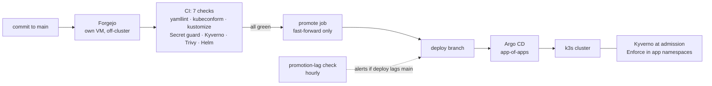

# GitOps Platform

Kubernetes delivery through Git, CI and Argo CD.

This is the desired state of my homelab's k3s cluster. Argo CD reconciles the cluster from Git, but only from a `deploy` branch that CI advances after seven checks pass. A broken manifest or a policy violation stays on `main` and never reaches the cluster. Write-ups and architecture are at [leemark.dev](https://leemark.dev).

## Why

The cluster is rebuilt from versioned configuration, not from memory. That only works if Git is the single source of truth and a bad commit cannot reach the cluster while it is being checked. An earlier version of this repo had good checks that ran at the same moment Argo CD applied the commit, so a check could only go red after the change was live. The fix was ordering, not more checks ([ADR 0003](docs/adr/0003-promotion-boundary.md)).

## Architecture



| Stage | What happens |
|---|---|
| **Validate** | yamllint; kubeconform on every manifest; `kustomize build` and a schema check on every overlay; no plaintext `Secret`; `kyverno apply` on raw manifests and rendered overlays; Trivy config scan plus image CVEs of changed images against a per-image baseline; `helm template` of every chart-backed Application at the pinned version |
| **Promote** | A `promote` job that `needs` all seven fast-forwards `deploy` to `main`. Never forced: if `deploy` has diverged it stops and asks for a human |
| **Reconcile** | Argo CD's root app tracks `deploy`. Child Applications sync automatically with self-heal (and prune, except for the storage, backup and upgrade components); tenant namespaces and prod sync by hand |
| **Admit** | Four Kyverno policies (requests and limits, no `latest` tag, readiness probes, app labels) run in Enforce in application namespaces and in Audit elsewhere, by design |
| **Watch** | Prometheus rules for platform components, SLO burn rates, backups, etcd disk latency and the promotion boundary itself |

## What's inside

| Area | Contents |
|---|---|
| [`clusters/homelab/apps/`](clusters/homelab/apps/) | Argo CD Applications for ingress-nginx, cert-manager, Kyverno, Longhorn, Velero, kube-prometheus-stack, Loki, Alloy, trivy-operator, system-upgrade-controller, the CI runner and BuildKit; one ApplicationSet for golden-path tenants; three AppProjects |
| [`clusters/homelab/config/`](clusters/homelab/config/) | Kyverno policies, Pod Security labels, quotas, LimitRanges, PDBs, PriorityClasses, read-only human RBAC, Cilium LB pool, cert-manager issuer and wildcard certificate, PrometheusRules, probe CronJobs, Grafana dashboards |
| [`clusters/homelab/values/`](clusters/homelab/values/) | Helm values for each chart-backed Application, plus the Argo CD install values |
| [`clusters/homelab/forgejo-runner/`](clusters/homelab/forgejo-runner/), [`buildkit/`](clusters/homelab/buildkit/) | CI build infrastructure: a host-executor runner with no cluster credentials and a rootless BuildKit reachable only from it |
| [`clusters/homelab/tenants/website/`](clusters/homelab/tenants/website/) | One tenant scaffolded by [Golden Path](https://github.com/leemarkus/k8s-golden-path): base, guard, SLO rules with Promtool tests, dev and prod overlays |
| [`.forgejo/workflows/validate.yml`](.forgejo/workflows/validate.yml) | The seven checks and the promotion job |
| [`tests/`](tests/), [`scripts/`](scripts/) | Offline tests and a local runner for the CI checks |
| [`docs/`](docs/) | ADRs and the secrets note |

## Verify it

Everything below runs offline. Tools: kustomize, kubeconform, kyverno, trivy, helm, yamllint, shellcheck, Python 3 with PyYAML; Promtool for the rule tests.

```sh
python3 scripts/validate-offline.py          # the CI jobs, locally; SKIP where a tool or input is missing
bash tests/trivy/test_gate.sh                # changed-image selection and baseline parsing
python3 tests/prometheus/test_renovate.py    # Renovate config shape and policy
python3 tests/prometheus/run.py              # Promtool unit tests for the etcd and Job-failure alerts
promtool test rules clusters/homelab/tenants/website/base/observe/tests/*.test.yaml   # tenant SLO rules
```

`validate-offline.py` reports kubeconform as SKIP unless `KUBECONFORM_SCHEMA_DIR` points at local schemas, and `helm template` as SKIP for charts not in the local Helm cache. It never downloads anything.

## Design decisions

- **A deploy branch is the promotion boundary.** Only fast-forward, CI-validated commits reach the cluster ([ADR 0003](docs/adr/0003-promotion-boundary.md)). Because a stuck gate is silent, an hourly check alerts when `deploy` falls more than six commits behind `main`.
- **Sealed Secrets is the one secrets path.** Encrypted in Git, decrypted only inside the cluster ([ADR 0001](docs/adr/0001-sealed-secrets-over-sops.md)). This copy ships none; see [docs/secrets.md](docs/secrets.md).
- **Git is hosted off-cluster.** Forgejo runs on its own VM, so recovering the cluster does not depend on the cluster.
- **Explicit AppProject fences.** `platform` lists by name every namespace it may touch, including the tenant namespaces whose budgets it owns; `apps` and `tenants` may deploy only into `*-dev`/`*-prod` namespaces, cannot create cluster-scoped resources beyond a Namespace, and tenants cannot set their own quotas.
- **Gate the change, not the drift.** Trivy gates only images a diff adds or changes, each against its own measured baseline, so a CVE published against an untouched image cannot hold an unrelated change.
- **Checks that guard the checks.** A PrometheusRule without the `release: kube-prometheus-stack` label applies cleanly and never fires; CI rejects it. The Helm job reads chart versions from the Applications themselves and asserts the count it parsed.

## Layout

```
.forgejo/            CI workflow, trivy helpers and per-image baselines
clusters/homelab/    the only deployment target (see its README)
docs/                ADRs and the secrets note
scripts/             validate-offline.py
tests/               trivy gate, Renovate config and Promtool rule tests
renovate.json        weekly dependency updates, no auto-merge
```

## Adapting it

Hostnames and addresses are placeholders: the Git server and Argo CD source is `git.example.com/platform/gitops`, images come from `registry.example.com`, ingress hosts are `*.apps.example.com`, and LoadBalancer, node and storage addresses use the RFC 5737 documentation ranges. Create the Secrets listed in [docs/secrets.md](docs/secrets.md) before syncing.

## Status

The cluster this describes is live and reconciled continuously by Argo CD. In this copy, the offline validator passes with no failures (kubeconform and `helm template` SKIP without local schemas and charts), and the trivy gate and Renovate tests pass. The Promtool suites need `promtool` installed.

The workflow is Forgejo Actions and is kept under `.forgejo/`. It expects a self-hosted runner with the tools preinstalled, a Forgejo API for promotion and a persistent Trivy cache, so it is not wired up as a GitHub Actions workflow here.

This repository is a curated public copy of a private one. Sealed secrets, host-specific probes, DNS configuration, personal workloads, operational runbooks and internal planning documents stay in the private repository. Host and VM configuration (Ansible) lives in a separate repository.

Author: Mark Lee
